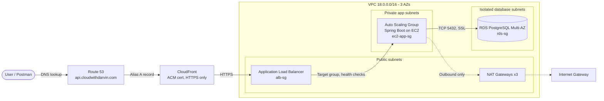

## Deploying Amazon EC2 Auto Scaling group and load balancer + RDS PostgreSQL using Terraform

When project teams host an application or service on an Amazon EC2 instance, they have specific questions about the
underlying infrastructure. A few of them could be:

* (a) Can the project team be assured that if some or all existing EC2 instances were terminated or unresponsive, new
  Amazon EC2 instances (with the application hosted) would be **auto-created**?
* (b) Can the number of Amazon EC2 instances scale based on **metrics** like CPU? Add more instances when the **load is
  high** and decrease them when it is low.
* (c) Can the project team implement a **zero downtime deployment** of the application hosted on Amazon EC2 instances?

**Amazon EC2 Auto Scaling group** is the answer to the use cases above. Per AWS-Docs, an Auto Scaling group contains a
collection of EC2 instances that are treated as a logical grouping for the purposes of automatic scaling and management.
An Auto Scaling group also lets you use Amazon EC2 Auto Scaling features such as health check replacements and scaling
policies.

### The Business Problem

***

A growing team runs a Spring Boot API (CRUD over REST, backed by PostgreSQL) for real users. Hosting it on a
single EC2 instance leaves the business exposed in several ways:

* **Downtime risk** — if the instance fails, or an Availability Zone has an outage, the application is unavailable until
  someone notices and fixes it by hand.
* **Unpredictable demand** — traffic varies. Sizing for peak load wastes money during quiet periods, and sizing for
  average load means slow responses or outages during spikes.
* **Risky releases** — each deployment means touching live servers, with no guarantee that users stay served while the
  change rolls out.
* **Security and compliance exposure** — public IPs, open SSH ports, shared bastion hosts, and hard-coded database
  passwords widen the attack surface and fail most audit requirements.
* **Poor visibility** — without centralised logs, metrics, and alerts, the team finds out about problems from customers
  rather than from monitoring.
* **Manual, unrepeatable infrastructure** — environments built by hand through the console drift over time and can't be
  reliably rebuilt or reviewed.

The business needs a platform that **stays available, scales with demand, can be updated without downtime, and keeps
data protected**, all while costing no more than the load requires.

### The Challenge

***

The goal is to design and deploy a production-grade, two-tier architecture on AWS, fully defined as code with Terraform,
that answers three questions the project team will ask about the infrastructure:

1. **Self-healing** — If some or all EC2 instances are terminated or become unresponsive, will replacements with the
   application already deployed be created automatically?
2. **Elastic scaling** — Can the number of instances grow when CPU load is high and shrink when it is low?
3. **Zero-downtime deployment** — Can a change to the application or instance configuration roll out without taking the
   service offline?

Meeting these goals while keeping the platform secure and observable raises several engineering challenges:

| Challenge                        | What the solution must deliver                                                                                                                                                            |
|:---------------------------------|:------------------------------------------------------------------------------------------------------------------------------------------------------------------------------------------|
| **High availability**            | Spread the ALB, application tier, and Multi-AZ RDS PostgreSQL database across 3 Availability Zones (`us-east-1a/b/c`), with one NAT Gateway per AZ.                                       |
| **Network isolation**            | Separate public, private application, and isolated database subnets. App and DB tiers have no public IP, and the database has no route to the internet.                                   |
| **Least-privilege access**       | Layer security groups (ALB → App → RDS), NACLs, VPC endpoints, and a scoped IAM instance role. No bastion host and no inbound SSH; administer instances through SSM Session Manager only. |
| **Secrets and encryption**       | Keep database credentials in AWS Secrets Manager with rotation, and encrypt RDS, CloudWatch Logs, and SNS with KMS. Enforce TLS in transit via ACM and CloudFront.                        |
| **Auto-scaling**                 | Build an Auto Scaling group from a launch template with CloudWatch-driven scale-out and scale-in policies, bounded by minimum and maximum capacity.                                       |
| **Safe deployments**             | Use an instance refresh that replaces instances in rolling fashion whenever the launch template changes, keeping a minimum healthy percentage so the service stays up.                    |
| **Secure delivery path**         | Route traffic through Route 53 → CloudFront → ALB → Auto Scaling Group → RDS, with HTTPS enforced end to end on a custom domain.                                                          |
| **Observability**                | Send ALB, application, and RDS logs to CloudWatch, with alarms, dashboards, and KMS-encrypted SNS email alerts.                                                                           |
| **Repeatability and governance** | Provision everything with Terraform and automate it through CI/CD pipelines, with Checkov scanning to catch security misconfigurations before they ship.                                  |

The project is considered successful when terminating an instance triggers an automatic replacement, a CPU load test
scales the fleet out and back in, a change to the instance type rolls out without downtime, and every CRUD endpoint
responds correctly through the public domain.

### Architecture overview

***

**Core Components**

* **Networking** — VPC with 3 AZs, public/private/database subnets.
* **ALB public facing** — Application Load Balancer (ALB) in public subnet (3 AZs) for distributing incoming traffic.
* **Application Tier** — EC2 instances backend App Tier in private subnet with SSM agent installed (which has NAT
  Gateway
  to access internet). **Access via SSM only** — no bastion host, no SSH inbound rule, no public IP on
  the app or DB tiers.
* **Auto Scaling** — Amazon EC2 Auto Scaling group.
* **Database Tier** — Data Tier RDS PostgreSQL (Multi-AZ) in isolated database subnets.
* **IAM role** — Instance role with policy to allow EC2 access for S3, SSM, RDS, KMS, Secrets Manger and CloudWatch.
* **S3** — Stores our application JAR file.
* **KMS** — KMS key for RDS, Secrets Manger, CloudWatch encryption.
* **AWS Secrets Manager** — To securely store, rotate, and manage database credentials.
* **Route 53/DNS tier** — Handle DNS resolution.
* **CloudFront** — CDN between Route 53 and the ALB.
* **Certificate Manager** — SSL/TLS termination with ACM certificates used by CloudFront[TO CONFIRM].
* **CloudWatch** — Log group for ALB, App tier and RDS database.
* **SNS** — Shared KMS-encrypted SNS topic + email subscription.
* **VPC Interface Endpoints**: for SSM, EC2 messages, and SSM messages.
* **VPC Gateway Endpoints**: for S3.
* **Security groups**: ```ALB-SG```, ```EC2-APP-SG```, ```RDS-SG``` and SSM Interface Endpoints.
* **Security**: Security Groups, NACLs, VPC endpoints, KMS for encryption, IAM roles with the least privilege.

Here is the architecture diagram related to the scenario we are going to address.


### Traffic Flow

***



#### Request path (inbound)

| # | Hop                          | What happens                                                                                                                                             | Controls                                                                          |
|:--|:-----------------------------|:---------------------------------------------------------------------------------------------------------------------------------------------------------|:----------------------------------------------------------------------------------|
| 1 | **Client → Route 53**        | The client resolves `cloudwithdarvin.com` or `api.cloudwithdarvin.com`. Both are alias A records pointing to the CloudFront distribution.                | Hosted zone for the existing domain                                               |
| 2 | **Route 53 → CloudFront**    | The request reaches the nearest CloudFront edge location. HTTP is redirected to HTTPS, and IPv6 is supported.                                            | ACM certificate (DNS-validated), TLS 1.2/1.3, `redirect-to-https`                 |
| 3 | **CloudFront → ALB**         | CloudFront applies its cache policy and forwards the request to the ALB origin.                                                                          | Cache policy for the ALB origin                                                   |
| 4 | **ALB → Auto Scaling Group** | The ALB, spread across three public subnets, picks a healthy target from the target group and forwards the request. Port 80 listeners redirect to HTTPS. | `alb-sg` (80/443), health checks, target group                                    |
| 5 | **EC2 (Spring Boot)**        | An instance in a private subnet handles the request. It accepts traffic from the ALB security group only and has no public IP.                           | `ec2-app-sg` (ingress from `alb-sg` only), NACLs                                  |
| 6 | **EC2 → RDS PostgreSQL**     | The app queries the Multi-AZ PostgreSQL database on port 5432. The database has no route to the internet.                                                | `rds-sg` (ingress from `ec2-app-sg` only), TLS in transit, KMS encryption at rest |

The response returns along the same path in reverse: RDS → EC2 → ALB → CloudFront → client.

#### Supporting traffic (non-user paths)

* **Outbound internet** — App-tier instances reach the internet (package installs, updates) through the NAT Gateway in
  their own AZ. Nothing on the internet can initiate a connection to them.
* **Private AWS service calls** — Instances reach Systems Manager, Secrets Manager (for the database password), and S3
  (for the application JAR) through VPC endpoints, so this traffic stays on the AWS network.
* **Administration** — Operators connect with **SSM Session Manager** only. There is no bastion host, no SSH rule, and
  no public IP on the app or database tiers.
* **Logs and metrics** — Instances, the ALB, and RDS send logs and metrics to CloudWatch. Alarms notify the team through
  a KMS-encrypted SNS topic.

#### Security boundaries

| Boundary               | Allowed in                             | Everything else |
|:-----------------------|:---------------------------------------|:----------------|
| Public subnets (ALB)   | 80/443 from the internet               | Denied          |
| App subnets (EC2)      | Application traffic from `alb-sg` only | Denied          |
| Database subnets (RDS) | 5432 from `ec2-app-sg` only            | Denied          |

Each tier accepts traffic only from the tier directly in front of it, so a compromise at one layer cannot reach past the
next.

### Architecture Benefits

***

* **Secure** — Private Application and Database tiers reduce direct internet exposure.
* **Scalable** — Auto Scaling Groups automatically maintain EC2 capacity based on the configured CPU target.
* **Load Balanced** — External ALB distributes web traffic and Internal ALB distributes application traffic.
* **Highly Available** — Resources are distributed across three Availability Zones.
* **Database Isolation** — RDS is deployed in private database subnets.
* **HTTPS** — ACM provides the SSL/TLS certificate used by the External ALB.
* **Custom Domain** — Route 53 provides DNS routing to the application.
* **CDN** — CloudFront between Route 53 and the ALB.

### Prerequisites

***

Before starting, ensure you have:

* Terraform >= 1.14
* AWS CLI v2 configured with valid credentials
* Java Development Kit (JDK 21+) and Maven 3.6+
* AWS Session Manager Plugin installed locally
* Git installed
* Active domain hosted on Route 53 (`cloudwithdarvin.com`)

### Implementation & Deployment

***

#### Step 1 — Infrastructure Provisioning with Terraform

Execute the following commands from the root terraform directory:

```bash
$ cd alb-autoscale-ec2/terraform
$ terraform init
$ terraform fmt -recursive
$ terraform validate
$ terraform plan -var-file="terraform.tfvars" -no-color -out=TFplan.JSON
$ terraform apply -var-file="terraform.tfvars" -auto-approve
$ terraform destroy -var-file="terraform.tfvars" -auto-approve
```


**Migration to remote backend**

- Add or activate backend configuration : ```terraform/backend.tf```
- Reinitialize to migrate state: ```terraform init -migrate-state```

#### Step 2 — Deployment Workflow

- ```checkov.yml``` — Automated security scanning framework using Checkov to detect Terraform misconfigurations at both
  repository and pull request (PR) levels
- ```deploy_infra.yml``` — Terraform workflow to provision infrastructure
- ```deploy_app.yml``` — Terraform workflow to deploy JAR Java Spring Boot application from S3 to EC2

### Verification & API Testing

***

You can check the full documentation for **technical specifications** in ```Documentation``` directory and all
screenshot in ```Screenshot verification```.

- **Launch Templates created with the desired specifications.**


- **EC2 instance created**


- **Auto Scaling Group with load balancer target group**


- **Amazon RDS PostgreSQL created**


- **CloudFront created**


- **Route 53 created**


- **Test our Application using Postman with Route 53 DNS**

    * Health Check: `GET https://api.cloudwithdarvin.com/health`
    * Create Note: `POST https://api.cloudwithdarvin.com/notes`
    * Create multi Note: `POST https://api.cloudwithdarvin.com/notes/save-all`
    * Get All Note and/or filter by title: `GET https://api.cloudwithdarvin.com/notes`
    * Get Note by ID: `GET https://api.cloudwithdarvin.com/notes/{id}`
    * Update Note: `PUT https://api.cloudwithdarvin.com/notes`
    * Delete Note: `DELETE https://api.cloudwithdarvin.com/notes/{id}`

### Break and Fix

***

### Terminate one of the EC2 instances

**Terminate** one of the EC2 instances from the AWS Console (select any _EC2 → Instance state → Terminate instance_).
After a few seconds, when you refresh the URL, you will notice that the link hovers between the one active EC2 instances
(instead of the two earlier).

If you navigate the Auto Scaling group page, you will notice some activity similar to the one below.


Similarly, in the EC2 Instances section, you’ll notice that a **new EC2 is initialized** in **the same availability
zone** as the previous (terminated) instance.


After a few minutes, you’ll notice that the new Amazon EC2 instance is part of the Load Balancer’s target group (check
_EC2 → Load Balancing → Target Groups_).


And on each URL refresh, the new instance’s webpage is added to the existing two. **So, that is how hosting an
application in an Auto Scaling group differs from hosting it on an Amazon EC2 instance**. We observed this behavior
because the `desired_capacity` of the autoscaling group is set to 2 (check the code repository). When we terminated one
instance, the autoscaling group came into effect and not only created a new instance but also added that to the load
balancer’s target group. Once the EC2 instance started reporting healthy, the load balancer also started routing traffic
to that instance.

### Steps to test both scaling policies

**Test target tracking**

Generate load with `hey`. Here `-c 20 -q 5` gives roughly 100 req/s for 15 minutes:
`hey -z 15m -c 20 -q 5 https://api.cloudwithdarvin.com/notes`


Press `Ctrl+C` to stop the script. After approximately 10 to 15 minutes or so, another EC2 instance was added by the
scaling policy, and I saw six instances. Even if there is high CPU consumption, there won’t be any more Amazon EC2
instances because the maximum size specified in the Amazon EC2 Auto Scaling group is 6.


After completing health check evaluations, the load balancer was routing traffic to all the Amazon EC2 instances. Here
is the image of the load balancer’s target group.


And that is how the scale-out policy works. Once I stopped the `hey` script [Ctrl+C], gradually, the Amazon EC2
instances were removed one by one until the number of active instances equaled the desired capacity. If I had not added
the scale-in policy, the number of Amazon EC2 instances would have remained high, defeating the purpose of having an
auto-scaling group.


**Test auto-scaling for CPU utilization**

Since the Amazon EC2 Auto Scaling group tracks the CPU Utilization metric, I installed a **stress** utility on the EC2
instance. The `user_data` script has the code to install that.

Connect to any Amazon EC2 instance using Session Manager and run the command:
`nohup stress --cpu "$(nproc)" --timeout 900 > /tmp/stress.log 2>&1 &`

### Cleanup

***

To destroy all resources, run ```terraform destroy -var-file="terraform.tfvars" -auto-approve```

### Summary

***

This project delivers a secure, highly available, and auto-scaling two-tier application platform on AWS, defined
entirely as code with Terraform. It answers the three questions raised at the start: instances are **self-healing**,
capacity **scales with CPU load and ALB request count**, and changes roll out through a **rolling instance refresh**
with no downtime.

We have successfully:

**Application**

* Built a Spring Boot CRUD REST API with externalized database configuration, packaged as a JAR and stored in S3
* Deployed the JAR to EC2 through the CI/CD workflow and tested all CRUD endpoints through the custom domain

**Networking and security**

* Created a VPC (`18.0.0.0/16`) across 3 Availability Zones with public, private application, and isolated database
  subnets
* Deployed one NAT Gateway per AZ, an Internet Gateway, and VPC Flow Logs to CloudWatch
* Isolated the tiers with chained security groups (`alb-sg` → `ec2-app-sg` → `rds-sg`) and an additional NACL layer
* Added VPC Interface Endpoints (SSM, SSM Messages, EC2 Messages, Secrets Manager) and an S3 Gateway Endpoint with a
  bucket-restricted policy
* Removed the bastion host, inbound SSH, and public IPs on the app and database tiers; access is through SSM Session
  Manager only
* Applied least-privilege IAM roles and an instance profile instead of hardcoded credentials

**Compute and scaling**

* Created a launch template (Ubuntu LTS, Java 21, CloudWatch Agent, AWS CLI, SSM Agent) and an EC2 Auto Scaling group in
  private subnets across 3 AZs
* Attached the Auto Scaling group to an Application Load Balancer target group with health checks and HTTP-to-HTTPS
  redirect
* Configured CloudWatch-alarm-driven scale-out and scale-in policies with a defined minimum and maximum capacity
* Enabled instance refresh on launch template changes, keeping a minimum healthy percentage for zero-downtime rollouts
* Verified self-healing by terminating an instance and watching the Auto Scaling group replace it in the same AZ

**Data and secrets**

* Deployed an encrypted RDS PostgreSQL Multi-AZ database in isolated subnets, reachable only from the application tier
  over TLS
* Stored database credentials in AWS Secrets Manager, with rotation
* Encrypted RDS, Secrets Manager, CloudWatch Logs, and SNS with KMS keys

**Public delivery**

* Set up Route 53 alias records for `cloudwithdarvin.com` and `api.cloudwithdarvin.com`
* Placed CloudFront between Route 53 and the ALB with HTTPS enforced, using DNS-validated ACM certificates (TLS 1.2/1.3)

**Monitoring**

* Created CloudWatch log groups, alarms, and dashboards for the ALB, the application tier, and RDS
* Sent KMS-encrypted SNS email alerts for critical events

**Automation**

* Provisioned all infrastructure with Terraform and automated it with GitHub Actions workflows for infrastructure
  deployment, application deployment, and Checkov security scanning

The result is a platform that recovers from instance failure on its own, adds and removes capacity as load changes, and
keeps the database and application servers off the public internet.
